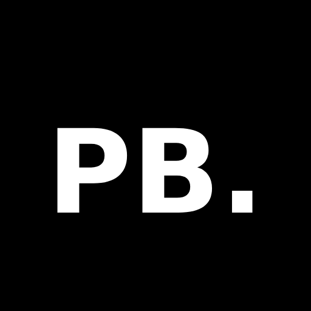

# Portfolio Site Builder

A small home for a body of work. The assistant handles the website; you keep the edit.



## Install, then start

For a desktop plugin workflow, use the installation panel at
[Photo Reason Lab](https://photoreason.art/en/lab/skills). Add the Photo Reason
marketplace once, then install Photo Reason Skills in your assistant's plugin UI.
The guide separates adding the source, installing the plugin, and updating later.
On a new Mac, [check Git before adding the marketplace](../../README.md#before-adding-the-codex-marketplace-on-a-mac). The terminal method below is an alternative for installing just this skill.

You need Node.js and a coding assistant that reads skills. In your website project folder:

```sh
npx skills add photoreason/skills --skill portfolio-site-builder
```

Choose your assistant in the installer, then open a new assistant session in that folder.
This command installs the skill; it does not publish a site. For plugin-manager alternatives,
see the [repository installation guide](../../README.md#install).
The command follows the [skills CLI documentation](https://github.com/vercel-labs/skills#install-a-skill).

Paste this as your first message:

> Use the portfolio-site-builder skill to help me make a website for my photographs.
> First ask which language I want to chat in: English / 日本語 / 简体中文.
> Then review costs and help me choose a publishing path. I want to keep control of the edit.

Bring a small selection of images you may publish, your name, a note about the work,
and a contact address. Your assistant may have a subscription cost. Hosting and a
custom web address are separate choices; check current prices in your currency first.

## Two ways to work

**Guided:** the assistant prepares the site and explains each browser step. You
handle account, domain, and publishing screens.

**Computer use:** if your assistant exposes a computer/browser-control tool, you
can grant it access to handle difficult steps such as uploading files or connecting
a domain. You keep control of sign-in, verification, purchases, and publication.
You can switch back to guidance at any time. Installing this skill alone does not
add mouse-control capability to a host that lacks it.

Both modes follow the same sequence:

1. Choose a chat language (English / 日本語 / 简体中文), then understand current costs and choose a budget/currency.
2. Gather photographs, introductions, project text, and any domain. An existing
   Namecheap, GoDaddy, Squarespace, Cloudflare, or Tencent Cloud registration can stay where it is.
3. Build from the supplied template, or recreate its layout in Squarespace.
4. Review a real preview on a phone and larger screen; make a revision.
5. Publish to Cloudflare Pages (recommended) or Squarespace when ready, verify
   the live address, and keep a short update guide.

Cloudflare remains the recommended template host for mainland China audiences.
Test the actual site from the audience's network; do not assume the result.
Portfolio building stays one skill. Standalone sequencing will be separate when ready.

## What guides the work

- **Your eye sets the sequence.** Suggestions should explain a choice, not override yours.
- **Let photographs lead.** Monochrome controls, space, and a layout suited to the series.
- **Costs before commitment.** A free starting address may be enough.
- **Leave files you can maintain.** The template separates structure from language and styling.

## Working study

Open [Study 01](examples/portfolio-study/index.html) in a browser after downloading the
repository. It uses the actual [bundled template](templates/portfolio/), with original
landscape illustrations in place of photographs. It is a layout demonstration, not
a photographer's portfolio, a client endorsement, or a record of an agent session.
The language switch, project view, and image viewer work locally, without a build.

**Example brief:** Make a portfolio for one coastal series. Quiet interface, large images,
English, Japanese, and Chinese.

**Example revision:** Give the images more room. Keep the series together rather than
turning every frame into a card. The study uses a single stacked sequence to demonstrate this.

## Making notes

The template begins with a project index. Stacked images support a deliberate sequence;
a grid supports looking across a body of work. Text lives in separate language files,
so translating a project does not require rebuilding its structure.

[Hairline's skill page](https://hairline.lucasmarkes.com/skills) and
[making notes](https://hairline.lucasmarkes.com/inspo) informed how we explain the work:
show a result, a prompt, and a reason for a change. Its assets and code are not used here.
For a real photographer's case study, record the actual brief and revision, secure
publication permission, and credit images. Do not present illustrative directions as a transcript.
